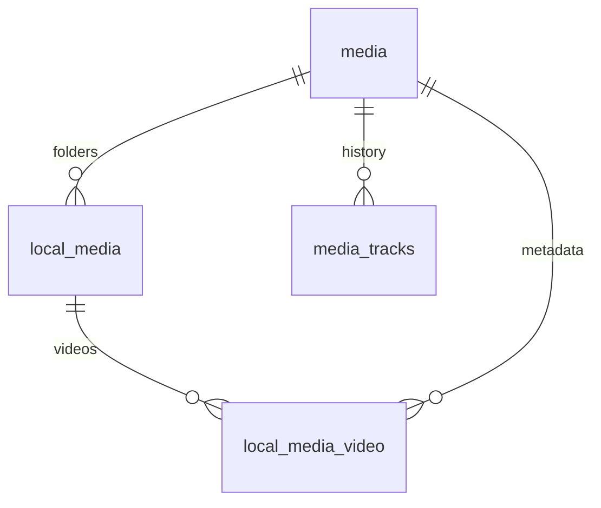

# 本地影视库 SQLite 简化设计

采用 **5 张业务表**：`media`、`local_media`、`local_media_video`、`media_tracks`、`task`。
`media_tracks` 用于观看历史和续播进度。目标结构保留 `auth_sessions`、`app_settings`，共 7 张表。
旧 `playback_progress` 在迁移完成前继续保留，验证无遗漏后才退出使用，不长期维护两份进度。
不再单独建作品、季、集或下载任务表；v6 增加的 `lib_folder` 只是目录扫描状态，不承载影视资料。

已实现建表迁移及对应 Model / Service / Controller，接口见 [影视库 API](catalog-api.md)。
当前 v7 包含 5 张业务表、`lib_folder` 目录扫描表，另保留旧进度、登录和配置三张表，共 9 张；旧进度迁移完成后的目标为 8 张。
[建表 SQL](../server/db/catalog-schema.sql) 是空数据库结构参考；已有数据库依次执行 [v4 建表](../server/db/migrations/004_catalog.sql)、[v5 数据源字段](../server/db/migrations/005_media_source.sql)、[v6 目录扫描](../server/db/migrations/006_lib_folder.sql) 和 [v7 视频源信息](../server/db/migrations/007_video_metadata.sql)，不能整份重放参考 SQL。
本阶段新接口直接查询 SQLite；现有首页、播放和文件浏览接口继续沿用原逻辑，未自动扫描或导入影视数据。

## media：影视信息

| 字段 | 内容 |
| --- | --- |
| `id` | 影视 ID |
| `title` | 标题 |
| `cover` | 封面地址或资源标识 |
| `media_type` | 类型，例如 anime / tv / movie |
| `data_source` | 数据源，例如 Bangumi、TMDB，可空 |
| `data_source_url` | 对应数据源的 HTTP/HTTPS 页面链接，可空 |
| `season` | 季号，整数 1、2、3……，默认 1 |
| `episode_count` | 正片总集数，非负整数，未知为 0；不等于本地已下载文件数 |
| `description` | 描述 |
| `rating` | 0–10 分，未知为 NULL |
| `tags` | JSON 数组，例如 `["科幻","日常"]` |
| `attribute` | 额外 JSON，对接来源 ID、别名等均放这里 |
| `aired_on` | 播出日期，例如 2026-10-01 |
| `series` | 系列名称，用于将第一季、第二季或剧场版归在一起 |
| `created_at / updated_at` | 创建与更新时间 |

一季对应一条 `media`，用 `series` 归组；电影也是一条影视记录，季号默认 1，前端可隐藏季号。
`media` 不保存视频时长；实际文件时长在 `local_media_video`，观看时长快照在 `media_tracks`。
元数据未抓取时，先用文件夹名建立影视记录，抓取完成后更新同一 ID。
不要按标题自动合并影视；多目录关联同一个 `media_id` 需确认是同一季 / 同一部。

## local_media：本地文件夹

| 字段 | 内容 |
| --- | --- |
| `id` | 本地目录 ID |
| `library_id` | 沿用现有多库 ID，例如 default / films |
| `folder_name` | 文件夹名称 |
| `folder_path` | 相对于该媒体库根目录的路径 |
| `folder_hash` | 库 ID + 规范化目录路径计算的 SHA-256 |
| `media_id` | 对应 `media.id` |
| `created_at / updated_at` | 创建与更新时间 |

一个影视可关联多个目录；媒体库根路径仍从 `server/.env` 获取，不额外建根目录表。
`folder_hash` 用于扫描去重，不是文件内容 hash，也不是目录身份。目录内增加视频不改变 hash。
目录改名时更新原记录的路径与 hash，保留 `id`；后台重新扫描不能仅凭相似文件名自动认定是移动。
Windows 路径按所在库规则统一大小写后计算 hash；路径统一 `/` 分隔。

## local_media_video：目录内的视频

| 字段 | 内容 |
| --- | --- |
| `id` | 视频 ID |
| `title` | 视频显示名称，默认文件名 |
| `cover_path` | 视频封面路径，可空；扫描时抽取中间帧生成 480p JPEG，保存为相对 `DATA_DIR` 的 `local-media/...`；空时回退影视封面 |
| `media_id` | 对应影视 ID |
| `video_index` | 播放顺序，允许 12.5 等编号 |
| `media_path` | 相对于 `local_media.folder_path` 的视频路径 |
| `local_media_id` | 对应目录 ID |
| `video_type` | main=正片，extra=番外；扫描时按 Bangumi `episode_count`、集号和特典目录/文件名自动归类，Agent 可用工具修正 |
| `duration_ms` | 当前文件实际时长 |
| `width / height` | 视频分辨率；扫描时由 ffprobe 写入，可空 |
| `frame_count` | 视频总帧数；优先取 nb_frames，缺失时按时长 × 帧率估算 |
| `size_bytes / mtime_ms` | 文件大小和修改时间，用于减少重复探测 |
| `missing` | 是否缺失，缺失保留记录 |
| `created_at / updated_at` | 创建与更新时间 |

把用户字段 `index` 规范为 `video_index`，拼写统一为 `media_path`、`local_media_id`。
通过组合外键保证视频的 `media_id` 与所属文件夹一致。文件路径在同一个目录记录内唯一。
不同清晰度可作为多个视频记录存在，相同 `media_id + video_index` 共享同一条观看进度。
同一影视内正片和番外的 `video_index` 也要区分，例如正片 12、番外 12.5，不能用相同集号表示不同内容。
电影目录下通常只有一个正片视频，番剧目录下按顺序包含多个视频；子目录用相对路径表示即可。

## media_tracks：观看历史

| 字段 | 内容 |
| --- | --- |
| `media_id` | 对应 `media.id`，联合主键第一列 |
| `video_index` | 集号，联合主键第二列 |
| `position_ms` | 播放位置，毫秒 |
| `duration_ms` | 此次观看记录中的视频总时长，毫秒 |
| `completed` | 是否看完，0 / 1 |
| `watched_at` | 最近观看时间 |
| `created_at / updated_at` | 首次创建与最后更新时间 |

使用 `PRIMARY KEY (media_id, video_index)`，没有独立 `id` 或 `video_id`。
同一影视同一集保留一条最近观看记录，用 `ON CONFLICT(media_id, video_index) DO UPDATE` 更新；反复上报不能插入重复记录。
观看历史按 `watched_at` 排序；首页最近看的番剧按 `media_id` 取最近一条记录。
重复观看同一集更新这条记录，第一版不记录每一次观看会话流水。
`media_id` 使用外键约束。写入历史时 Service 校验该影视与集号确实存在于本地视频中；因同一集可有多个文件，历史不直接外键关联某一个视频文件。
文件失联或目录离线时保留历史；路径变化或切换视频文件不改变联合主键。不同版本时长不同时，Service 需将续播位置限制在实际时长内。

## 字幕约定

字幕无需单独的持久化表：播放时按同目录、相同基础文件名匹配外挂，支持语言后缀。
例如 `第01集.mkv` 对应 `第01集.ass`、`第01集.chs.ass`、`第01集.zh-CN.srt`。
内封字幕由 ffprobe 探测、ffmpeg 按需提取；音轨、编码信息也按需探测，不写入观看历史表。
提取出的 WebVTT 按「视频绝对路径 + 大小 + mtime + 字幕流序号」缓存在 `DATA_DIR/subtitles/`，属于可随时删除的派生数据，不进入 SQLite。首次提取边读边流式返回，文件变更后按新 key 重新提取。
图形字幕仍按现有播放器 / 转码能力处理。

## lib_folder：目录扫描状态（v6）

| 字段 | 内容 |
| --- | --- |
| `id` | 主键 |
| `parent_id` | 父目录，根目录为 NULL |
| `library_id` | 媒体库 ID，由代码固定 |
| `rel_path` | 相对媒体库根目录，`''` 为根，统一 `/` 分隔 |
| `name / depth` | 目录名与深度 |
| `mtime_ms` | 上次观测到的目录 mtime |
| `entry_count` | 直接子项数量，用于兜底判断 |
| `scanned_at` | 上次扫描完成时间 |
| `status` | pending / scanned / failed / missing |
| `error` | 失败摘要 |

唯一键 `(library_id, rel_path)`。目录被删除时保留记录并标记 `missing`，默认不展示。
分类结论不写在这里：目录是否已绑定影视由 `local_media.folder_hash` 反查。

## task：通用任务

| 字段 | 内容 |
| --- | --- |
| `id / type` | 任务 ID、任务类型 |
| `status` | queued / running / succeeded / failed / cancelled |
| `progress` | 0–100 的进度 |
| `payload` | 输入参数 JSON |
| `result / error` | 结果 JSON、错误摘要 |
| `run_after` | 最早可执行时间，0 表示立即可执行 |
| `created_at / updated_at / started_at / finished_at` | 任务时间信息 |

`type` 不限制为扫描，可使用 `scan_library`、`fetch_metadata`、`download_video` 等类型。
`payload` 例如 `{"libraryId":"default","localMediaId":12}` 或 `{"mediaId":3,"source":"..."}`。
不存 API Key 等密钥；任务只引用服务端配置。任务参数由对应 Service 校验，Agent 不直接执行任意数据库写入。
`run_after` 支持延迟执行；周期调度后续按需要增加，不为了未来功能预先增加任务相关表。
任务领取使用短事务和条件更新，避免两个 worker 领取同一任务；同库扫描不能并发，由扫描 Service 控制。
重启后处理遗留 running 任务，下载任务重试前检查目标文件，避免重复下载或覆盖。

## 关系与运行方式

后续扫描 / 抓取 / 下载将通过 `task` 执行，完成后由 Service 更新上述表。
当前已提供任务记录、取消、原子领取、进度及完成 / 失败状态流转；尚无自动扫描或下载执行器，创建任务不会触发实际下载。
视频、字幕、封面本体继续在磁盘上。拼接路径为“环境变量库根路径 + folder_path + media_path”，读文件仍校验目录穿越和软链接越界。
目录丢失、网络盘离线或扫描失败时保留记录与历史，不能因一次访问失败就删除整库。
只有某个扫描范围完整成功后，才将确定未发现的视频标记为 missing；增量扫描不能处理范围之外的视频。

现有观看进度先保持原接口和表结构。实施时按旧 `(library_id, path)` 匹配到本地视频的 `(media_id, video_index)`，将旧进度导入 `media_tracks`。
新表时间和时长用毫秒；旧 `playback_progress.time/duration` 使用秒，迁移时转换，旧 `at` 对应 `watched_at`。
多个文件的旧记录映射到同一 `(media_id, video_index)` 时取最新 `at`，保留该记录的进度和时长。未匹配、离线库和已移除库的历史继续保留并兼容读取，不能直接丢弃旧表。
历史和续播接口最终统一读取 `media_tracks`，确认全部迁移完成后才退出旧 `playback_progress`。

启动逻辑已改为版本化迁移：保留旧数据后逐步升级到 v7，事务内完成各版本迁移后再标记版本；较新的数据库版本会被拒绝，不能降级写入。
所有连接启用 foreign_keys。CRUD、路径规范化、历史校验、任务流转放在 Service；SQL 在 Model；Controller 处理 HTTP 参数和响应。
