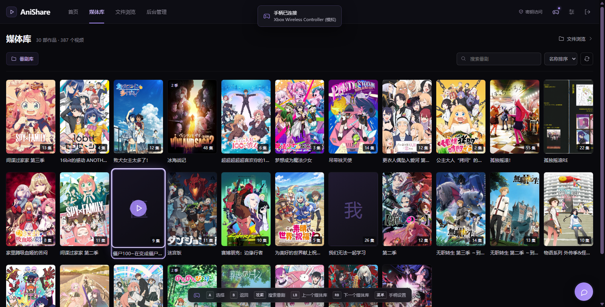
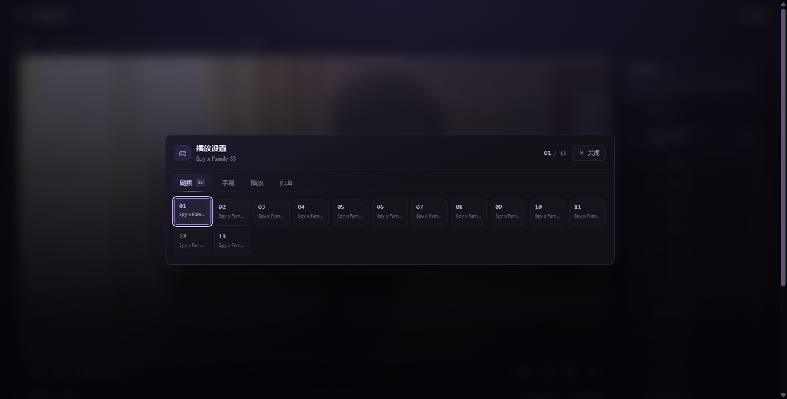
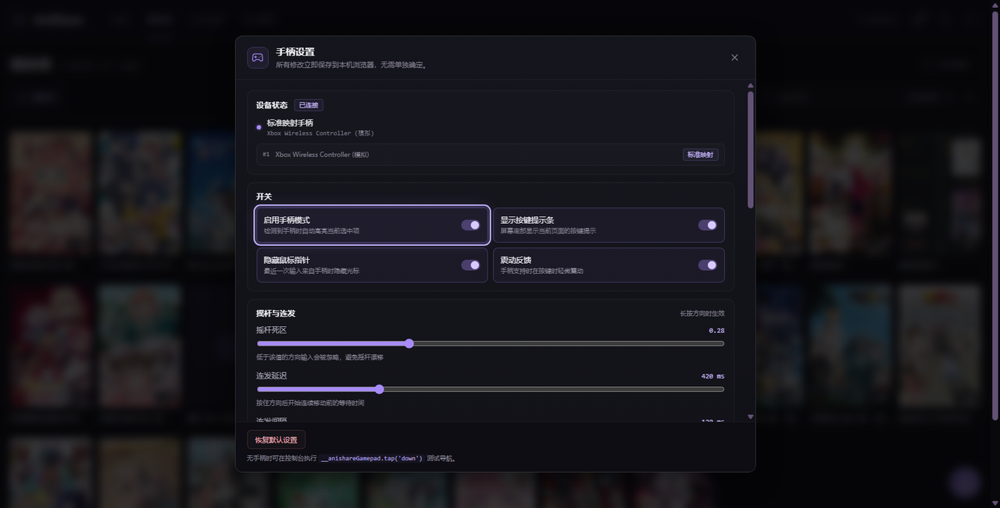

# 手柄（Gamepad）交互设计

目标：所有前端页面都能只用手柄完成浏览、选择、播放和设置。手柄接入后自动进入「手柄模式」，
当前选中项以类似主机游戏库的方式高亮；左右摇杆 / 十字键负责移动，A 确认，B 返回。

## 0. 界面预览

接入手柄后（截图中为模拟手柄）：媒体库卡片高亮 + 底部按键提示条 + 顶部连接提示：



播放器 Y 键打开的「播放设置」浮层，摇杆选择剧集 / 字幕 / 播放参数 / 页面跳转：



Start / 顶栏手柄图标打开的手柄设置（死区、连发、改键、实时按键测试）：



## 1. 浏览器能力与限制

| 事实 | 影响 |
| --- | --- |
| Gamepad API 用轮询读取：`navigator.getGamepads()` + `requestAnimationFrame` | 需要常驻的输入引擎，不能只靠事件 |
| `gamepadconnected` / `gamepaddisconnected` 事件 | 用于连接提示、模式切换 |
| 标准映射（standard mapping）下按键/摇杆索引固定 | 默认映射按标准手柄设计，非标准手柄退回十字键 + 摇杆 |
| Firefox 81+ / 规范要求 **安全上下文**（HTTPS 或 localhost）才提供手柄 API；Chrome 在内网 HTTP 下也可能返回空列表 | **部署在本机时用 `http://localhost:6001` 没问题；电视/局域网访问建议给 Nginx 配 HTTPS**。设置页会检测并给出提示 |
| 浏览器不允许脚本读取键盘/IME 组合输入 | 文本输入（登录密钥、搜索、后台配置）用内置「手柄虚拟键盘」输入 ASCII；中文搜索仍建议鼠标/键盘 |
| 震动 `vibrationActuator.playEffect('dual-rumble')` | 可选反馈，失败时静默忽略 |
| 原生 `<select>` 弹出层不受页面控制 | 方向键聚焦 select 时，左右键直接切换选项，不打开原生弹层 |

## 2. 交互模型

### 2.1 全局

| 输入 | 行为 |
| --- | --- |
| 十字键 / 左摇杆 | 空间导航：在可见元素之间按方向找最近的目标，选中并高亮 |
| A | 确认（点击按钮 / 链接 / 打开输入框虚拟键盘 / 切换 select） |
| B | 返回（关闭浮层，否则路由后退）。**四个主菜单页面禁用**：首页、媒体库、文件浏览根目录、后台管理；子页面 / 播放器照常返回 |
| X / Y | 页面上下文动作（播放器：X 切换字幕、Y 播放设置；媒体库：X 排序等） |
| LB / RB | 切换上下文页签 / 上一集 · 下一集 / 上下一个媒体库 |
| Start | 打开「手柄设置」 |
| 截图 / Share（可选按键 17） | 播放器：切换视频全屏 / 退出全屏（其他页面无动作，可在设置里改键） |
| 长按摇杆 | 方向键连发：先延迟 420ms，之后每 120ms 一次（可调） |

手柄模式激活条件：检测到已连接手柄（`navigator.getGamepads()` 中有可用设备）。
模式下：

- `html.gp-mode`，所有可聚焦元素获得高亮环；卡片类元素（`data-gp-card`）放大 + 光晕，模拟主机游戏库选中效果；
- 手柄接入后自动把焦点放到当前页的默认落点（`data-gp-autofocus`），高亮立即可见；
  播放器等「媒体控制」页面例外（见 2.3），保持无焦点以让方向键直接控制播放；
- 屏幕底部出现按键提示条（`GamepadHUD`），内容随当前页面上下文变化；
- 最近输入来自手柄时隐藏鼠标指针（可关）；
- 鼠标移动、点击仍完全可用，不会抢走焦点；手柄输入重新接管。

### 2.2 焦点模型

- 采用**真实 DOM 焦点**：`el.focus({ preventScroll: true })`，保证 Tab / 读屏 / 现有键盘操作不受影响。
- **B 返回层级限制**：首页、媒体库、后台管理、文件浏览根目录属于主菜单页面，按 B 不触发浏览器后退
  （HUD 也不显示 B 提示）；进入作品详情、播放器、文件浏览子文件夹后 B 恢复为返回。
- 选中元素打上 `data-gp-focused` 属性（由 `focusin`/`focusout` 同步），供 CSS 高亮。
- 浮层打开时焦点限制在浮层根节点（`[data-gp-overlay]`）内；关闭后恢复原焦点。
- 空间导航算法：按方向取候选元素，用「主轴距离 + 垂直偏移惩罚 - 正交重叠奖励」打分，取最小者；
  网格海报墙会优先停在同一列，横滑列表会自动 `scrollIntoView`。
- 页面切换后若焦点丢失，下一次方向输入自动回到 `[data-gp-autofocus]`（各页面第一个卡片）。

### 2.3 播放器（重点）

播放器是「媒体控制模式 + 控制台式菜单」两层：

- 焦点在页面主体时（含刚进入播放器）：
  - A 播放 / 暂停，← → 快退 / 快进（单击 10s，按住连发 30s），↑ ↓ 音量 ±5%；
  - LB / RB 上一集 / 下一集；X 循环字幕；Y 打开播放设置浮层；Start 打开全局手柄设置；B 返回；
  - **截图 / Share 键切换视频全屏 / 退出全屏**（原生全屏需要浏览器用户手势，被拒时自动退化为 CSS 网页全屏）；
  - 视频尚未就绪（转码会话启动中）时方向键只提示「视频还在准备中」，避免反复重建转码会话；
- Y 打开的浮层（`PlayerPad`，`data-gp-overlay`）用摇杆选择：
  - **剧集**：按集数网格选择，直接切集（打开时焦点落在当前集）；
  - **字幕**：关闭 / 外挂 / 内挂轨道选择；
  - **播放**：播放暂停、上一集/下一集、倍速、音量、全屏；
  - **页面**：返回番剧、媒体库、首页等链接；
  - LB / RB 切换页签；B 关闭浮层后回到媒体控制模式（焦点恢复到打开前的位置，通常是无焦点）；
  - START 打开的是全局「手柄设置」，两者互不干扰。

### 2.4 手柄设置

`GamepadSettings`（浮层，可用 Start 或顶栏手柄按钮打开）：

- 状态：已连接设备、标准映射、安全上下文 / API 是否可用提示；
- 开关：启用手柄模式、显示提示条、隐藏鼠标指针、震动；
- 摇杆：死区、连发延迟、连发间隔、反转 Y 轴、使用左/右摇杆；
- 按键映射：逐动作改键（按下新手柄按键自动捕获），可恢复默认；
- 按键测试：实时显示摇杆轴值与按键状态；
- 所有设置即时保存到 `localStorage['anishare.gamepad.v1']`。

### 2.5 手柄虚拟键盘

A 命中文本输入框时打开 `GamepadKeyboard`：字母 / 数字 / 符号布局，摇杆移动、A 输入，
支持空格、退格、清空、完成、取消；通过原生 value setter + `input` 事件写回，兼容 Vue `v-model`。
用于登录密钥、搜索框、后台配置项。

## 3. 代码结构

```
web/src/gamepad/
├── constants.js        # 按键/动作定义、默认映射与偏好、存储键
├── store.js            # 响应式单例状态：连接、模式、偏好、浮层、提示、实时输入
├── spatial.js          # 纯函数：摇杆→方向、方向候选打分（可单测）
├── engine.js           # 手柄轮询、按键边沿/连发、连接事件、震动、改键捕获、调试注入
├── nav.js              # 可聚焦元素收集、空间移动、聚焦/激活、浮层焦点限制
├── dispatch.js         # 动作分发：上下文栈 → 浮层 → 默认导航/确认/返回
├── useGamepad.js       # Vue 组合式 API：useGamepad / useGamepadContext
├── GamepadProvider.vue # 全局挂载点（App.vue），驱动 engine + HUD + 浮层
├── GamepadHUD.vue      # 底部提示条 + 连接/断开提示
├── GamepadSettings.vue # 手柄设置浮层
├── GamepadKeyboard.vue # 虚拟键盘浮层
└── PlayerPad.vue       # 播放器「播放设置」浮层（剧集/字幕/播放/页面）
```

数据流：

```
Gamepad API ──轮询──> engine.js ──动作(动作名, meta)──> dispatch.js
                                                      ├─> 上下文栈（页面通过 useGamepadContext 注册）
                                                      ├─> 浮层内导航 / 关闭
                                                      └─> nav.js（空间移动、确认、返回）
nav.js ── focus()/data-gp-focused ──> DOM + CSS 高亮
store.js <── 偏好、连接、提示、浮层、实时按键 ──> HUD / Settings / Keyboard / PlayerPad
```

页面接入方式：

```js
// 任意视图组件中注册上下文按键与提示（组件卸载自动注销）
useGamepadContext({
  id: 'library',
  hints: { 'prev-tab': '上一个媒体库', 'next-tab': '下一个媒体库' },
  handle(action) {
    if (action === 'next-tab') { selectNextLibrary(); return true }
  },
})
```

浮层组件注册时要加 `overlay: true`，这样浮层打开期间页面上下文不会抢走按键；
坚持「无焦点媒体控制」的页面（播放器）加 `keepFocusless: true`，手柄接入时不自动聚焦页面元素。

## 4. 接口契约

### constants.js

```js
export const STORAGE_KEY = 'anishare.gamepad.v1'
export const BUTTON = { A:0,B:1,X:2,Y:3,LB:4,RB:5,LT:6,RT:7,BACK:8,START:9,LS:10,RS:11,UP:12,DOWN:13,LEFT:14,RIGHT:15,HOME:16,SHARE:17 }
export const BUTTON_LABELS = ['A','B','X','Y','LB','RB','LT','RT','返回','菜单','L3','R3','↑','↓','←','→','HOME','截图']
export const ACTION = {
  UP:'up', DOWN:'down', LEFT:'left', RIGHT:'right',
  CONFIRM:'confirm', BACK:'back', CONTEXT:'context', MENU:'menu', SEARCH:'search',
  PREV_TAB:'prev-tab', NEXT_TAB:'next-tab', SETTINGS:'settings', FULLSCREEN:'fullscreen',
}
export const DIRECTION_ACTIONS = ['up','down','left','right']
export const DEFAULT_MAP = { confirm:0, back:1, context:2, menu:3, 'prev-tab':4, 'next-tab':5, settings:9, search:8, fullscreen:17 }
export const DEFAULT_HINTS = { confirm:'选择', back:'返回', settings:'手柄设置' }
export const DEFAULT_PREFS = {
  enabled:true, deadzone:0.28, repeatDelay:420, repeatInterval:120,
  vibration:true, hintBar:true, hideCursor:true, invertY:false, stick:'left', map:{...DEFAULT_MAP},
}
```

### store.js

```js
export const gamepad = reactive({
  supported: Boolean, secure: Boolean, connected: Boolean,
  devices: [{ index, id, mapping }], activeIndex: Number, id: String, mapping: String,
  mode: Boolean,          // 手柄模式（高亮 + 提示条）
  pointer: Boolean,       // 最近输入是否来自鼠标
  prefs: {...DEFAULT_PREFS},
  overlay: null,          // { kind:'settings' } | { kind:'keyboard', target } | { kind:'player' }
  live: { buttons: [], axes: [], id: '' },  // 设置页按键测试
  toast: null,            // { text, sub, at }
  hints: {...DEFAULT_HINTS},
})
export function loadPrefs()
export function savePrefs(patch)      // 合并 + 校验 + localStorage
export function resetPrefs()
export function setPointer(active)
export function openOverlay(payload)  // 记录打开前焦点
export function closeOverlay()
export function showToast(text, sub)
```

### spatial.js（纯函数）

```js
export function directionFromStick(axes, prefs) // -> {x,y}|null（死区/反转/左右摇杆）
export function pickDirection(currentRect, candidates, direction) // candidates:[{rect, order}] -> candidate|null
export function centerOf(rect)
```

### engine.js

```js
export function startEngine(onAction)  // -> stop()
export function captureNextButton(timeoutMs, cb) // cb(buttonIndex|null)
export function injectAction(action, pressed)    // 调试/测试：绕过物理手柄
```

### nav.js

```js
export function focusRoot()            // 浮层根 或 document.body
export function collectFocusables(root)
export function ensureFocus()          // 当前焦点无效时聚焦 [data-gp-autofocus] 或首个可聚焦元素
export function moveFocus(direction)   // -> Element|null
export function focusElement(el)
export function activateFocused()
export function focusFirstIn(root)
```

### dispatch.js / useGamepad.js

```js
export function installGamepad({ router }) // -> dispose；engine 启动 + 默认动作处理 + 调试入口
export function registerGamepadContext({ id, hints, handle, overlay, keepFocusless }) // -> unregister
export function closeCurrentOverlay()      // 关闭浮层并恢复焦点
export function refreshHints()             // 重新合并提示条内容
export function shouldSuppressAutoFocus()  // 当前页面是否要求保持无焦点
export function useGamepad()               // { gamepad, prefs, supported, secure, openOverlay, closeOverlay, captureNextButton, savePrefs, resetPrefs }
export function useGamepadContext({ id, hints, handle, overlay, keepFocusless, enabled }) // 组件生命周期内注册
```

`handle(action)` 返回 `true` 表示已消费该动作，默认导航不再执行。

### 调试入口

没有实体手柄时，可在浏览器控制台注入逻辑动作，验证整条交互链路：

```js
__anishareGamepad.tap('down')       // 方向
__anishareGamepad.tap('confirm')    // A
__anishareGamepad.tap('settings')   // Start
__anishareGamepad.press('right')    // 按住（长按连发）
__anishareGamepad.release('right')
```

## 5. 高亮样式约定

| 选择器 | 作用 |
| --- | --- |
| `html.gp-mode` | 手柄模式根标记 |
| `html.gp-mode [data-gp-focused]` | 通用高亮环（2px 主色描边 + 外发光） |
| `html.gp-mode [data-gp-card][data-gp-focused]` | 卡片放大 `scale(1.04)` + 光晕 + 提升层级 |
| `html.gp-mode.gp-hide-cursor` | 隐藏鼠标指针（最近输入为手柄时） |
| `[data-gp-autofocus]` | 页面/浮层默认落点 |
| `[data-gp-overlay]` | 浮层根（限制焦点范围） |
| `[data-gp-skip]` | 导航时跳过的元素 |

## 6. 测试

- 单元测试 `web/test/gamepad.test.mjs`（12 项）：摇杆死区/反转、方向候选打分（网格选列、同排移动、空白方向）、
  连发状态机、偏好读写与容错、上下文注册与提示合并、截图键→全屏映射与改键、主页面 B 返回禁用规则。
- 构建 `npm --prefix web run build`；`npm --prefix web test` 全部通过。
- 浏览器端到端冒烟（无实体手柄也能跑）：注入逻辑动作后逐项断言。
  本次实现用 Chrome DevTools Protocol 在真实页面验证了 33 项：

  | 场景 | 验证内容 |
  | --- | --- |
  | 首页 | 首次方向键产生默认高亮、命中 `data-gp-autofocus`、继续移动、真实 DOM 焦点 |
  | 手柄设置 | Start 打开/关闭浮层、焦点限制在浮层内、浮层内方向导航、设备状态与按键测试区块 |
  | 登录 | 输入框按 A 打开虚拟键盘、按键写入、B 关闭且保留输入 |
  | 媒体库 | A 进入媒体库、海报墙卡片聚焦、View 键聚焦搜索框、虚拟键盘写入搜索框 |
  | 播放器 | Y 打开播放设置、焦点落在当前集、LB/RB 切页签、B 关闭并回到媒体控制模式 |
  | 播放控制 | → 快进、← 快退、↑ 音量，全程无未捕获 JS 异常 |
  | 全屏 | 无实体手柄时用 `__anishareGamepad.tap('fullscreen')` 注入动作，真实手柄按截图 / Share 键 |

- 无实体手柄时可在浏览器控制台调试：
  `__anishareGamepad.tap('down')`、`__anishareGamepad.tap('confirm')`、`__anishareGamepad.press('right')`。

## 7. 已知限制

- 内网纯 HTTP 访问时，部分浏览器不提供 Gamepad API（安全上下文限制），需 HTTPS 或本机 localhost；
  设置页会显示检测结果与说明。电视 / 局域网设备建议在 Nginx 上启用 HTTPS 后再用手柄。
- 虚拟键盘只输入 ASCII；中文输入仍依赖系统输入法/鼠标键盘。
- 非标准映射手柄按标准索引猜测；如有错位可通过「按键映射」逐项改键。
- 浏览器要求用户手势才能进入**原生全屏**；手柄按键不产生用户手势时，播放器会自动退化为
  CSS 网页全屏（铺满浏览器可视区）。截图键在部分浏览器/手柄上可能不暴露为按键 17，可在「手柄设置 → 按键映射」里改键。
- 浏览器原生控件（`<select>` 弹层、日期选择器等）无法被页面脚本驱动，已用左右键切换 / 自定义浮层替代。
- 转码流在会话启动/重新起转期间不可 seek：此时方向键只提示「视频还在准备中」，
  避免连续 seek 反复重建 ffmpeg 会话；就绪后快进/快退恢复正常（快退跨越会话起点时会重新起转，需等待新会话出片）。

## 8. 实现清单

| 文件 | 说明 |
| --- | --- |
| `web/src/gamepad/constants.js` | 按键/动作定义、默认映射、偏好与限制、虚拟键盘布局 |
| `web/src/gamepad/store.js` | 响应式单例：连接、模式、偏好（localStorage `anishare.gamepad.v1`）、浮层、提示、实时按键 |
| `web/src/gamepad/spatial.js` | 纯函数：摇杆→方向、方向候选打分、连发状态机 |
| `web/src/gamepad/engine.js` | 轮询 Gamepad API、动作边沿/连发、震动、改键捕获、调试注入 |
| `web/src/gamepad/nav.js` | 可聚焦元素收集、空间移动、聚焦/激活、滚动、浮层焦点限制、`data-gp-focused` 同步 |
| `web/src/gamepad/dispatch.js` | 上下文栈 → 浮层 → 默认导航的动作分发 |
| `web/src/gamepad/useGamepad.js` | 组合式 API：`useGamepad` / `useGamepadContext` |
| `web/src/gamepad/GamepadProvider.vue` | 全局挂载：engine、模式 class、HUD/设置/键盘、浮层自动聚焦 |
| `web/src/gamepad/GamepadHUD.vue` | 底部提示条 + 连接/断开 toast |
| `web/src/gamepad/GamepadSettings.vue` | 手柄设置浮层（开关 / 摇杆参数 / 改键 / 实时测试） |
| `web/src/gamepad/GamepadKeyboard.vue` | 手柄虚拟键盘浮层 |
| `web/src/gamepad/PlayerPad.vue` | 播放器播放设置浮层（剧集 / 字幕 / 播放 / 页面） |
| `web/src/views/Player.vue` | 媒体控制模式、字幕循环、倍速/音量、全屏切换、播放设置浮层接线 |
| `web/src/App.vue` | 全局挂载 `GamepadProvider`、顶栏手柄设置入口与连接指示 |
| `web/src/views/*.vue` | `data-gp-card` / `data-gp-autofocus` 标记与各页焦点选中样式 |
| `web/src/styles/main.css` | `html.gp-mode` 高亮环、卡片放大光晕、隐藏指针、减少动效降级 |
| `web/test/gamepad.test.mjs` | 空间导航 / 连发 / 偏好 / 上下文单测 |
